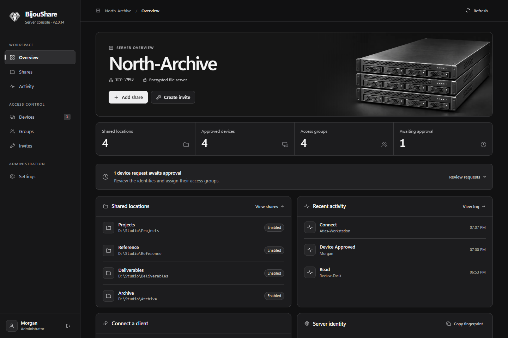
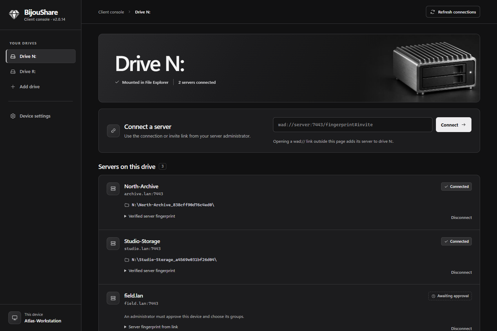
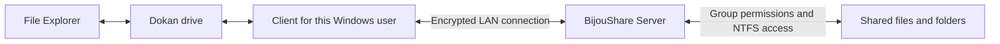

# BijouShare

BijouShare lets you share files, folders, and entire Windows drives across a LAN. On the client, shares open in File Explorer under a drive letter you choose. One drive can hold folders from several servers, and each Windows user has their own connections and device identity. Administrators use the server's web console to decide which devices can read, change, or delete files.

## Screenshots

The BijouShare **2.0.14** consoles are shown below with sample devices and shares. The version under the BijouShare logo identifies the running client or server.

**Server overview.** The administrator can see which locations are shared, review a device awaiting approval, and create an invite.

**Client drive.** Drive N: has two connected servers and a third awaiting approval. The sidebar lets the user switch drives or add another drive letter.

## Prerequisites

- **Windows.** The x64 installers require administrator privileges. Both computers need a Windows build with native support for ML-KEM-768 and SHA3-256. [Microsoft's Windows cryptography support](https://learn.microsoft.com/windows/win32/seccng/cng-algorithm-identifiers)
- **Dokan on each client.** Before installing BijouShare Client, install the 64-bit Dokan runtime and matching driver, version **2.3 or later in the 2.x series**. Dokan provides the virtual drive that File Explorer opens. A server-only installation uses the Windows filesystem directly. [Download Dokan](https://github.com/dokan-dev/dokany/releases)
- **LAN access.** Clients must be able to reach the server's LAN hostname or IP address on TCP **7443** by default. Allow inbound traffic on that port from your LAN in the server's firewall.

## Technical overview

**Identity and encryption.** Each server and each Windows user's client profile keeps an ECDH P-256 key pair and an ML-KEM-768 key pair. Their full SHA3-256 public-key fingerprint stays the same across display-name changes. The client checks the server against the full fingerprint in its connection link, and both peers prove possession of their private keys. Each connection combines fresh ECDH and ML-KEM contributions to derive separate AES-256-GCM keys for sending and receiving file traffic.

**Access and concurrent use.** Devices inherit access through their groups. The server checks the applicable share and path rules for each operation. An explicit deny overrides an allow, including a grant from the permanent **Administrator** group. The server service also needs the Windows permissions required for the operation. Multiple readers can open a file, and the server allows one writable handle at a time, subject to Windows sharing flags.

**Drive layout and reconnection.** Each server appears as a folder named after the server and the first 16 characters of its fingerprint, for example `N:\North-Archive_838cff90d76c4ed0\Projects`. If a server goes offline, the client hides its folder and keeps the drive mounted. The folder returns after reconnection. Reopen any files whose connection was lost.

**Browsing media folders on a slow connection.** Directory listings contain names, sizes, attributes, and timestamps. Explorer may then read parts of photos or videos to generate thumbnails or preview a selected file. On the client, open **File Explorer → … → Options → View**, select **Always show icons, never thumbnails**, and click **Apply**. This affects Explorer for that Windows user across all drives. Turn off the **Preview pane** under **View → Show** (or press **Alt+P** if it is open). For video or music folders, use **Details** view with basic columns such as **Name**, **Size**, and **Date modified**. Media-specific columns such as **Length** can trigger additional file reads. BijouShare presents its mounts as fixed drives, so a Windows policy scoped only to network folders may miss them. [Windows thumbnail policies](https://learn.microsoft.com/windows/client-management/mdm/policy-csp-admx-thumbnails)

**Services and storage.** The server service hosts the shares and web console even when everyone signs out. Its tray helper opens the console in the signed-in session. The client service starts a worker for each signed-in Windows user. Client keys and drive settings live under `%USERPROFILE%\.bijoushare`. The server stores its identity, approved devices, groups, and access rules under `%ProgramData%\BijouShare\Server` by default.

## Setup

1. **Install the server.** On the computer hosting the files, run `BijouShare.Server-2.0.15-win-x64-Setup.exe` and approve elevation. Open **BijouShare Server** from the system tray, under **Show hidden icons** if needed. Enter a server name, an administrator name, and a password of at least 14 characters. Sign in.
2. **Publish a share.** Choose **Shares → Add share**, name the share, and enter its local path. Give the server's **LOCAL SERVICE** account the NTFS access it needs there. Under **Groups**, add a group and set its permissions for that share.
3. **Invite the client.** On **Overview → Connect a client**, enter a LAN hostname or IP address the client can reach. Under **Invites → Create invite**, select the group and set the use limit and expiration. Send the complete invite link through a trusted channel. It contains the server fingerprint and a code that approves the device.
4. **Install the client.** After installing Dokan, run `BijouShare.Client-2.0.15-win-x64-Setup.exe` and approve elevation. Open **BijouShare Client** from the system tray and choose a device name. Select **Add drive** and pick an unused letter.
5. **Open the share.** Select that drive in the client sidebar, paste the invite under **Connect a server**, and click **Connect**. Once the status reads **Connected**, open the drive in File Explorer and browse to the server folder and share.

For manual approval, send the **Overview → Connect a client → Copy link** connection link in step 3. After the client connects, open **Devices** on the server, approve the waiting device, and assign its groups.

To change ports, open **Settings → Listening ports** on the server. The file service defaults to TCP **7443** and the local web UI to **5080**. After a web UI port change, the console reopens on the new port and the tray icon uses that address. For remote HTTPS access, allow the new web port through your firewall before saving. If you reach the console through a proxy on a different port, open it from the server tray to change its listener. Deployments with explicit Kestrel endpoints or multiple web URLs manage those bindings in their hosting configuration.

After a file service port change, existing connections can finish on the old port. Update your firewall rule and copy a fresh connection link from **Overview**. Once file transfers finish, clients can disconnect the old server entry from their drive and reconnect using the new link. Device approvals and group memberships carry over.

For unattended installation, run either installer from an elevated terminal with `/quiet /norestart`. Both services start automatically with Windows.
