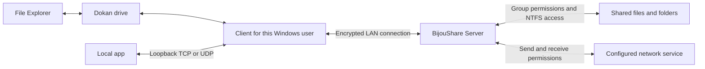

# BijouShare

BijouShare shares files, folders, entire Windows drives, and TCP or UDP services across a LAN. File shares open in Explorer under a drive letter you choose. Network services are available to local apps through a port you choose. Each Windows user has their own connections and device identity. Administrators manage access through groups in the server console.

## Screenshots

The BijouShare **2.0.14** consoles are shown below with sample devices and shares. The version under the BijouShare logo identifies the running client or server.

**Server overview.** The administrator can see which locations are shared, review a device awaiting approval, and create an invite.


**Client drive.** Drive N: has two connected servers and a third awaiting approval. The sidebar lets the user switch drives or add another drive letter.


## Features

### Windows drives and file operations

- **Share a file, folder, or entire drive.** Give each share a display name and enable or disable it from the server console.
- **Use fixed drive letters in Explorer and Windows apps.** Client setup starts with zero drives. Choose a letter and a name for each drive, then add its servers. Rename a drive in File Explorer or on its tab in the client console. Existing drives keep the name BijouShare until you rename them.
- **Browse several servers on one drive.** Each server gets a folder named `ServerName_First16FingerprintCharacters`, with its shares underneath.
- **Manage files in place.** Browse and copy files, create folders, edit or resize files, rename items, and delete them according to the device’s permissions. Applications can also read and set supported attributes and timestamps.
- **Coordinate simultaneous access.** Multiple readers can open a file. The server allows one writable handle per file, honors Windows sharing flags, and supports byte-range locks.

### Network services

- **Share a TCP or UDP endpoint.** In the server console, open **Shares → Add share → Network service**. Enter a name, the destination host and port as seen from the server, and **TCP**, **UDP**, or **Both**. Network services appear in the client console, separate from File Explorer.
- **Grant each direction separately.** In **Groups**, add a rule for the service. **Send** allows the client to send to the destination. **Receive** allows the destination to reply or send data to the client. Request-and-response services usually need both. Explicit denies take precedence across groups, including Administrator. A rule on the built-in **All** share can grant these directions for current and future services.
- **Choose a local port per service.** In the client console, open **Network services**, enter an unused local port, and select **Start listener**. Point your app at `127.0.0.1` on that port. For example, a TCP service exported on port 8080 can listen locally on 18080. With **Both**, the same local port must be available for both protocols. Choose **Stop listener** to release the port or change it.
- **Keep listeners private across sign-ins.** Enabled services and port choices are saved in your Windows profile. Before opening a port, the installed client service uses Windows Filtering Platform rules to restrict that port to your account’s security identifier (SID). Apps running as your account can use the listener. Windows blocks other accounts’ TCP connections and UDP traffic, including replies. If Windows cannot apply the rules, the port stays closed.
- **Use UDP with local apps.** Each UDP app registers its local endpoint by sending a datagram to the listener. For receive-only access, its registration datagram stays on the client.

### Device enrollment and invites

- **Connect with a Web Attached Data (WAD) link.** Open a `wad://` link from a webpage or paste it into the client console to connect to a server. The link carries the full server fingerprint and an optional invite code. Once connected, the client can access permitted file shares through a drive and network services through local listeners.
- **Approve devices manually.** Review a pending device’s name, fingerprint, and first and last contact times. Choose its groups when approving it. To remove a blocked device or rejected request, expand its name in **Devices** and select **Forget device**. This clears the block and discards any previous group memberships. The device must enroll again under the current enrollment policy.
- **Issue several invites at once.** Assign groups to each invite, choose a use limit or unlimited uses, and set an expiration or let it run indefinitely. Copy the code when it is issued. In **Invites**, select **Remove** beside a **Used up** or **Revoked** invite to clear its record. To retire a code that still has uses remaining, select **Revoke** first. Devices already enrolled keep their groups.
- **Require an invite for new devices.** New servers start in invite-only mode. A new device needs a valid invite to enroll. The client explains a rejection in its console and sends a tray notification. Previously approved devices can reconnect with their existing identity.
- **Manage access after enrollment.** Change a device’s groups, disable it, or re-enable it. The server checks the current authorization on file requests, including requests on existing connections.

### Groups and permissions

- **Assign access through groups.** A device can belong to several groups. Devices with no groups have no share access. Manage memberships from **Devices** and edit share permissions directly from **Groups**.
- **Set permissions for current and future shares.** In **Groups**, choose **All (built-in)** to cover every current and future share. Access applies only while a share is enabled. Select **Include files and folders below this path** to cover its contents as well. Explicit denies take precedence. The built-in target adds no folder in Explorer. A physical share named **All** remains individually selectable and appears at its usual path.
- **Scope rules by path.** Apply a rule to a whole share, one file or folder, or a folder and its descendants. The server combines matching grants across groups, and explicit denies take precedence.
- **Separate editing from deletion.** Control listing, reading and writing data, creating files and folders, renaming, deleting, reading and changing attributes, and reading permissions. The **Read and write** preset lets devices create and edit while leaving rename and delete as separate choices.
- **Grant administrator access explicitly.** The permanent **Administrator** group grants full control on enabled shares, including newly added ones. Matching denies from another group still apply. Membership requires manual assignment and is unavailable through invites.
- **Respect Windows storage permissions.** File operations run as the server’s Windows account. The server also excludes its private data, client profiles, and reparse points such as junctions and symbolic links from exports.

### Identity and encryption

- **Separate profiles for each Windows user.** Each signed-in user has their own device name, keys, saved servers, and drive configuration under `%USERPROFILE%\.bijoushare`. The Windows Data Protection API protects the private keys for that user.
- **Keep identities across renames.** Device and server fingerprints are derived from their persistent ECDH and ML-KEM public keys using SHA3-256. Changing a display name preserves the fingerprint and device enrollment.
- **Verify both peers.** The client checks the full server fingerprint before sending an invite. The handshake proves possession of both peers’ identity keys, and the client flags a fingerprint mismatch.
- **Encrypt file traffic in both directions.** Each connection combines ECDH P-256 and ML-KEM-768 secrets to derive separate AES-256-GCM keys for sending and receiving. The receiver rejects altered or replayed encrypted frames.

### Performance and recovery

- **Browse large folders in pages.** The server filters filename patterns and sends compact entries with basic attributes, sizes, and timestamps. Explorer can still request file contents separately for previews or thumbnails.
- **Overlap file requests.** The binary transfer protocol supports up to 16 requests in flight per connection and file payloads up to 1 MiB per request. Independent reads can overlap while the server preserves the order of changes.
- **Reconnect without losing drive layout.** The client keeps a previously connected server’s folder visible briefly while Wi-Fi returns. If the outage continues, it hides that folder and keeps retrying. Other servers on the drive stay available.
- **Keep open files across sleep.** With client and server 2.0.20 or later, the client can reconnect to the original open files and byte-range locks. If a write loses its reply, the client checks what the server recorded before continuing. An operation reports an error if recovery exceeds its timeout or the server can no longer confirm the outcome.
- **Resume a disconnected file session.** The server can retain open files and their locks for up to 24 hours after a disconnect. If the server restarts, Windows unmounts the drive, or the session expires or is evicted, applications must reopen their files. The client restores a lost mount on its configured letter.

### Administration and deployment

- **Manage both services from a browser.** System tray icons open the client and server consoles. Each client drive has its own tab showing mount status, connected servers, fingerprints, and connection errors, with a manual refresh option.
- **Control access to management.** The client console listens on loopback and requires the signed-in user’s access token for management requests. Server setup runs locally, administrator sign-in is rate-limited, and remote administration requires HTTPS.
- **Review activity and diagnose failures.** The server console shows the latest 200 audit events, and the server keeps daily logs. Error details can identify a missing group permission, a Windows storage denial, or the device holding a conflicting file handle.
- **Monitor file transfers.** Open **Transfers** on the client for activity across this Windows user’s drives. The server **Overview** shows all devices combined, then each enrolled device. Each graph plots one minute of read, write, and combined speeds in one-second intervals. The separate byte counters persist across restarts. Reads measure file data sent to a client and writes measure file data received from it. Folder listings, protocol overhead, and reads served entirely from a local cache are excluded.
- **Change listening ports at runtime.** Administrators can change the file-service port and, on a directly managed web endpoint, the console port. The browser waits for the new web address and then redirects. Existing file connections can finish on the old file port.
- **Install interactively or unattended.** Separate x64 installers register each role as an automatic Windows service. They support silent setup, unattended setup with progress, repair, and uninstall. The client installer checks for the Dokan runtime and driver.
- **Check connectivity from the command line.** The client’s `--probe` command reports enrollment status and lists authorized shares without mounting a drive.

## Prerequisites

- **Windows.** The x64 installers require administrator privileges. Both computers need a Windows build with native support for ML-KEM-768 and SHA3-256. [Microsoft's Windows cryptography support](https://learn.microsoft.com/windows/win32/seccng/cng-algorithm-identifiers)
- **Dokan on each client.** Before installing BijouShare Client, install the 64-bit Dokan runtime and matching driver, version **2.3 or later in the 2.x series**. Dokan provides the virtual drive that File Explorer opens. A server-only installation uses the Windows filesystem directly. [Download Dokan](https://github.com/dokan-dev/dokany/releases)
- **LAN access.** Clients must be able to reach the server's LAN hostname or IP address on TCP **7443** by default. Allow inbound traffic on that port from your LAN in the server's firewall.

## Technical overview



**Identity and encryption.** Each server and each Windows user's client profile keeps an ECDH P-256 key pair and an ML-KEM-768 key pair. Their full SHA3-256 public-key fingerprint stays the same across display-name changes. The client checks the server against the full fingerprint in its connection link, and both peers prove possession of their private keys. Each connection combines fresh ECDH and ML-KEM contributions to derive separate AES-256-GCM keys for sending and receiving file traffic.

**Access and concurrent use.** Devices inherit access through their groups. The server checks the applicable share and path rules for each operation. An explicit deny overrides an allow, including a grant from the permanent **Administrator** group. The server service also needs the Windows permissions required for the operation. Multiple readers can open a file, and the server allows one writable handle at a time, subject to Windows sharing flags.

**Drive layout and reconnection.** Each server appears as a folder named after the server and the first 16 characters of its fingerprint, for example `N:\North-Archive_838cff90d76c4ed0\Projects`. After wake, the client keeps the folder visible briefly while it reconnects. If the server stays offline, the client hides its folder and keeps the drive mounted. The folder returns automatically when the server reconnects. Open files remain usable when the original file session resumes.

**Network service transport.** Each local TCP connection or UDP peer gets a dedicated authenticated connection to the same BijouShare server port. The client selects a share by ID. The server looks up the configured destination, checks the device’s permissions, and opens a socket to that endpoint. UDP datagrams keep their message boundaries across the encrypted TCP connection. Encryption between the server and the destination depends on the service’s own protocol. Removing access closes the affected connections. After an outage, applications can open a new connection through the saved listener. Profiles with zero drives can connect using **Network services → Connect a server**.

**Browsing media folders on a slow connection.** Directory listings contain names, sizes, attributes, and timestamps. Explorer may then read parts of photos or videos to generate thumbnails or preview a selected file. On the client, open **File Explorer → … → Options → View**, select **Always show icons, never thumbnails**, and click **Apply**. This affects Explorer for that Windows user across all drives. Turn off the **Preview pane** under **View → Show** (or press **Alt+P** if it is open). For video or music folders, use **Details** view with basic columns such as **Name**, **Size**, and **Date modified**. Media-specific columns such as **Length** can trigger additional file reads. BijouShare presents its mounts as fixed drives, so a Windows policy scoped only to network folders may miss them. [Windows thumbnail policies](https://learn.microsoft.com/windows/client-management/mdm/policy-csp-admx-thumbnails)

**Services and storage.** The server service hosts the shares and web console even when everyone signs out. Its tray helper opens the console in the signed-in session. The client service starts a worker for each signed-in Windows user. Client keys and drive settings live under `%USERPROFILE%\.bijoushare`. The server stores its identity, approved devices, groups, and access rules under `%ProgramData%\BijouShare\Server` by default.

**Using a drive with elevated apps.** Open the installed client from the tray, select the drive, and click **Allow elevated apps**. Approve the Windows prompt as the account that mounted the drive. Apps running as administrator in that account's linked session can then use the same drive letter and server permissions as Explorer. The client remembers this approval for the drive. After a reboot, sign-in, or remount, its Windows service restores the mapping for the same account. Sleep, Wi-Fi loss, and an offline server leave the approval in place. Choose **Turn off elevated access** to revoke it. If a previously approved server blocks the device or removes its enrollment, the client revokes elevated access for that drive when it receives the authenticated rejection. Other drives keep their own approvals.

This option requires a Windows administrator account with UAC's paired normal and elevated sessions. If the letter is taken in the elevated session, the client reports the conflict. A Windows policy that requires entering fresh credentials can create a separate logon session outside that pair. [Microsoft's explanation of UAC and drive letters](https://learn.microsoft.com/en-us/troubleshoot/windows-client/networking/mapped-drives-not-available-from-elevated-command)

**Launching from Explorer.** With elevated access enabled, right-click a shared executable and choose **Run as administrator**, or open it normally if the app requests elevation itself. On a local NTFS profile, BijouShare registers the volume at a private folder so Windows can resolve the executable during the UAC prompt. The drive letter stays in your sign-in session and its approved elevated session. If the client reports that your profile cannot support Explorer elevation, launch the executable from an already elevated terminal in its own folder.

## Setup

1. **Install the server.** On the computer hosting the files, run `BijouShare.Server-2.1.0-win-x64-Setup.exe` and approve elevation. Choose **Local Service** or **Administrator** as the Windows service account. For Administrator, enter the password for the local Windows account shown. Open **BijouShare Server** from the system tray, under **Show hidden icons** if needed. Enter a server name, an administrator name, and a password of at least 14 characters. Sign in.
2. **Publish a share.** Choose **Shares → Add share**, name the share, and enter its local path. Give the server's Windows account (by default, **LOCAL SERVICE**) the NTFS access it needs there. Under **Groups**, add a group and set its permissions for that share. [Changing the server service account](#changing-the-server-service-account)
3. **Invite the client.** On **Overview**, enter a LAN hostname or IP address the client can reach. Under **Invites → Create invite**, select the group and set the use limit and expiration. Send the complete invite link through a trusted channel. It contains the server fingerprint and a code that approves the device.
4. **Install the client.** After installing Dokan, run `BijouShare.Client-2.1.0-win-x64-Setup.exe` and approve elevation. Open **BijouShare Client** from the system tray or Start menu and choose a device name. Select **Add drive**, choose an unused letter, and enter a drive name.
5. **Open the share.** Select that drive in the client sidebar, paste the invite under **Connect a server**, and click **Connect**. Once the status reads **Connected**, open the drive in File Explorer and browse to the server folder and share.

For manual approval, open **Settings → Device enrollment**, turn off **Invite only**, and save. In step 3, send the connection link from **Overview → Connect a client → Copy link**. After the client connects, open **Devices**, choose its groups, and approve it. Turning **Invite only** back on pauses manual approval, including requests already waiting. Upgrades preserve your existing enrollment setting.

To change ports, open **Settings → Listening ports** on the server. The file service defaults to TCP **7443** and the local web UI to **5080**. After a web UI port change, the console reopens on the new port and the tray icon uses that address. For remote HTTPS access, allow the new web port through your firewall before saving. If you reach the console through a proxy on a different port, open it from the server tray to change its listener. Deployments with explicit Kestrel endpoints or multiple web URLs manage those bindings in their hosting configuration.

After a file service port change, existing connections can finish on the old port. Update your firewall rule and copy a fresh connection link from **Overview**. Once file transfers finish, clients can disconnect the old server entry from their drive and reconnect using the new link. Device approvals and group memberships carry over.

For unattended installation, run either installer from an elevated terminal with `/quiet /norestart`. Both services start automatically with Windows.

### Changing the server service account

To switch an **already installed** server to the built-in local Windows Administrator account, finish any active transfers and run this from the folder containing Server Setup:

```powershell
.\BijouShare.Server-2.1.0-win-x64-Setup.exe /serviceaccount
```

Approve elevation and enter the displayed account’s Windows password. Setup checks that Windows permits a service logon, changes the account, restarts the server, and reports when it is running. The built-in Administrator must be enabled and have a password. Setup recognizes a renamed account by its Windows identity. The web console has its own administrator login.

For an interactive upgrade, select Administrator again and enter the password to keep that account. Unattended installations use the Local Service default. To use another Windows account or change back to Local Service, use the service’s **Log On** tab.

If a device can browse a share but cannot create a folder, check **Activity** in the server web UI for the failed operation. For an NTFS denial, you can grant the service account **Create folders / append data** on the affected directory. If you choose to run the service under an existing Windows administrator account, follow these steps on the server PC. This gives the entire server process local administrator privileges. BijouShare still enforces its device and group rules.

1. Open **Services** from Start using **Run as administrator**. Elevating the BijouShare tray shortcut only elevates the tray.
2. Open **BijouShare Server → Properties → Log On → This account**. Enter `.\YourAdminUser`, replacing `YourAdminUser` with the local administrator's username. Enter and confirm the account password. Windows Hello PINs cannot be used for service logon.
3. Click **Apply → OK**. Keep the startup type set to **Automatic**. Once active transfers finish, right-click **BijouShare Server** and select **Restart**.
4. Open **Shares** in the server web UI. Check that **Windows accesses these paths as** shows the selected account, then retry the operation from the client. Check this setting again after an installer upgrade, which can restore the default `NT AUTHORITY\LocalService` account.

## Build from source

From the repository root on x64 Windows, run the following in 64-bit PowerShell 7.4 or later. The build needs the .NET 10 SDK, the Windows .NET Framework 4.x compiler, and SHA3-256 support for installer checksums.

```powershell
.\Installer\Build.ps1
```

The script restores its dependencies, including WiX 5.0.2 and its Util extension, so the first build needs access to NuGet. It publishes the client and server, builds both setup executables, and verifies the files inside each package. The installers and checksums are written to `artifacts\bijoushare\installers\`.
